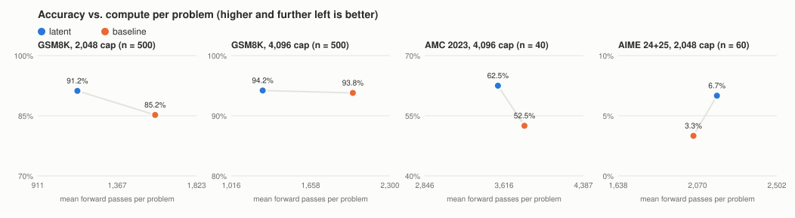

# Psiduck-AI

**Can a team of LLM agents reason together in latent space, passing hidden states instead of English, and match a single model's accuracy while generating less text?**

<!-- TLDR:START (generated by analyze.py; do not edit) -->

On 500 GSM8K problems (Qwen3-8B) with a 4,096-token cap, the latent pipeline reached **94.2%** vs **93.8%** for single-model chain-of-thought (no statistically significant difference) while generating **42.9% fewer tokens**, using 0.64x the forward passes and 36.8% less wall-clock time.
At a 2,048-token cap (Experiment 1), the latent pipeline scored 91.2% vs 85.2% (statistically significant), with 36.3% fewer generated tokens, 0.72x the forward passes and 29.8% less wall-clock time; there the baseline ran out of budget on 185/500 problems vs 53/500 for latent. That accuracy gap disappears once the baseline has room to finish.
AIME 2024+2025 (n = 60) and AMC 2023 (n = 40) showed no statistically significant difference.

<!-- TLDR:END -->

Psiduck-AI is a multi-agent reasoning system in which every agent runs on one shared open-weights model. The agents never write messages to each other. Each specialist "thinks" by feeding its own hidden state back into the model as the next input, and every agent's prompt and latent thoughts accumulate in one shared KV cache. Only the final decoder produces text.

Psiduck-AI's latent design builds on [LatentMAS](https://arxiv.org/abs/2511.20639) (Zou et al., 2025). We evaluated it against a single-model chain-of-thought baseline on the same model.

## How it works

```
                       one shared model, one shared KV cache
 ┌───────────────────────────────────────────────────────────────────────────────┐
 │ [algebra prompt][30 latent steps] → [counting prompt][30 latent steps] →       │
 │ [number-theory prompt][30 latent steps] → [geometry/verify prompt][30 latent]  │
 │ → [decoder prompt] → generated answer text … \boxed{N}                         │
 └───────────────────────────────────────────────────────────────────────────────┘
```

1. **Specialist delegates run one after another**: algebra → counting → number theory → geometry and verification. Each one reads a short prompt naming its role and the problem.
2. **Latent steps.** After its prompt, each delegate takes 30 latent steps. The final-layer hidden state at the last position is rescaled to the norm of a typical input embedding and fed back in as the next input. No token is sampled. Each step adds one position to the shared KV cache.
3. **Shared KV cache.** Nothing is summarized or pooled between agents. Every later agent attends to every earlier agent's prompt and latent positions.
4. **Decoder.** A final decoder prompt is appended, and the model generates the answer. It uses the same decoding settings, token cap and answer instruction as the single-model baseline: Qwen3 thinking mode on, temperature 0.6, top-p 0.95, 2,048 tokens.

The **baseline** is the same model, answering the same prompt with English chain-of-thought.

The method is in [`psiduck/pipeline.py`](psiduck/pipeline.py) and the model primitives are in [`psiduck/backbone.py`](psiduck/backbone.py).

## Results

The results below are generated from [`SUMMARY.md`](SUMMARY.md) by `analyze.py`.



<!-- RESULTS:START (generated by analyze.py from SUMMARY.md; do not edit) -->

Generated by `analyze.py` from `results/`. Do not edit by hand.

- Model: `Qwen/Qwen3-8B` (bf16), sampling at temperature 0.6, top-p 0.95, seed 42, thinking on, max new tokens 2048, latent steps/delegate 30.
- GSM8K: first N = 500 problems of the test split after a seed-42 shuffle.
- Problems that raised an error count as incorrect.

### GSM8K (N = 500)

| config | correct | accuracy | mean generated tokens | mean forward passes | mean wall s/problem | errors | hit token cap |
| --- | --- | --- | --- | --- | --- | --- | --- |
| baseline | 426/500 | 85.2% | 1584.7 | 1585.3 | 57.5 | 0 | 185 |
| latent | 456/500 | 91.2% | 1009.9 | 1138.8 | 40.3 | 0 | 53 |

**latent vs baseline** (paired, n = 500): both correct 420, only latent 36, only baseline 6, neither 38. Accuracy difference +6.0 points.

- Generated tokens: latent generated 36.3% fewer tokens than baseline (token reduction +36.3%).
- Forward passes (counts prompt reads, latent steps and decoding): latent used 0.72x the baseline's.
- Wall-clock time (measured per problem, same GPU): latent took 29.8% less time than baseline.
- Verdict: latent is more accurate than the baseline, and the difference is statistically significant.

### AIME 2024 + 2025 (60 problems)

| config | correct | accuracy | mean generated tokens | mean forward passes | mean wall s/problem | errors | hit token cap |
| --- | --- | --- | --- | --- | --- | --- | --- |
| baseline | 2/60 | 3.3% | 2048.0 | 2048.0 | 75.2 | 0 | 60 |
| latent | 4/60 | 6.7% | 2048.0 | 2176.0 | 80.0 | 0 | 60 |

**latent vs baseline** (paired, n = 60): both correct 1, only latent 3, only baseline 1, neither 55. Accuracy difference +3.3 points.

- Generated tokens: latent generated 0.0% fewer tokens than baseline (token reduction +0.0%).
- Forward passes (counts prompt reads, latent steps and decoding): latent used 1.06x the baseline's.
- Wall-clock time (measured per problem, same GPU): latent took 6.3% more time than baseline.
- Verdict: no statistically significant accuracy difference between latent and the baseline (+3.3 points, alpha = 0.05).

### Experiment 2: AMC 2023 (40 problems, 4,096-token cap)

| config | correct | accuracy | mean generated tokens | mean forward passes | mean wall s/problem | errors | hit token cap |
| --- | --- | --- | --- | --- | --- | --- | --- |
| baseline | 21/40 | 52.5% | 3814.4 | 3814.7 | 138.8 | 0 | 30 |
| latent | 25/40 | 62.5% | 3428.8 | 3557.2 | 132.1 | 0 | 25 |

**latent vs baseline** (paired, n = 40): both correct 17, only latent 8, only baseline 4, neither 11. Accuracy difference +10.0 points.

- Generated tokens: latent generated 10.1% fewer tokens than baseline (token reduction +10.1%).
- Forward passes (counts prompt reads, latent steps and decoding): latent used 0.93x the baseline's.
- Wall-clock time (measured per problem, same GPU): latent took 4.8% less time than baseline.
- Verdict: no statistically significant accuracy difference between latent and the baseline (+10.0 points, alpha = 0.05).

### Experiment 3: GSM8K at a 4,096-token cap (500 problems)

| config | correct | accuracy | mean generated tokens | mean forward passes | mean wall s/problem | errors | hit token cap |
| --- | --- | --- | --- | --- | --- | --- | --- |
| baseline | 469/500 | 93.8% | 1998.9 | 1999.8 | 71.6 | 0 | 56 |
| latent | 471/500 | 94.2% | 1141.3 | 1270.3 | 45.3 | 0 | 21 |

**latent vs baseline** (paired, n = 500): both correct 463, only latent 8, only baseline 6, neither 23. Accuracy difference +0.4 points.

- Generated tokens: latent generated 42.9% fewer tokens than baseline (token reduction +42.9%).
- Forward passes (counts prompt reads, latent steps and decoding): latent used 0.64x the baseline's.
- Wall-clock time (measured per problem, same GPU): latent took 36.8% less time than baseline.
- Verdict: no statistically significant accuracy difference between latent and the baseline (+0.4 points, alpha = 0.05).

<!-- RESULTS:END -->

## Limitations / threats to validity

<!-- LIMITATIONS:START (generated by analyze.py; do not edit) -->

- **One model.** Every result uses Qwen3-8B (bf16); results may not transfer to other models or sizes.
- **One sampled run per problem.** Decoding samples at temperature 0.6 with a fixed seed per problem; run-to-run variance is not measured beyond the paired test.
- **Baseline truncation.** At the 2,048-token cap the baseline hit the cap on 185/500 GSM8K problems vs 53/500 for latent, so part of the accuracy gap could come from finishing within the budget. Experiment 3 shows the gap disappears at a 4,096-token cap (no statistically significant difference, n = 500).
- **Latent content vs. extra context.** No control replaces or removes the latent states, so it is untested whether the gain comes from their content or simply from the extra latent positions.
- **AIME and AMC are inconclusive.** On AIME both configs hit the cap on every problem, and AMC has only 40 problems; neither supports a conclusion.
- **What the compute numbers mean.** Generated tokens count only written text; forward passes also count latent steps and prompt reads; wall-clock times come from one NVIDIA A40 at batch size 1.

<!-- LIMITATIONS:END -->

## Setup

Requirements: Python 3.10+ and an NVIDIA GPU with CUDA. Qwen3-8B in bf16 needs about 20 GB of GPU memory; set `PSIDUCK_QUANT=nf4` to load it in 4-bit (bitsandbytes) on smaller GPUs.

```bash
python -m venv .venv
source .venv/bin/activate            # Windows: .venv\Scripts\activate
pip install torch --index-url https://download.pytorch.org/whl/cu128
pip install -r requirements.txt
python scripts/prefetch.py           # caches GSM8K, AIME 24/25 and the model weights
```

The Hugging Face cache lives in `.hf_cache/` inside the repo, and benchmark data is cached in `data/`.

## Usage

```bash
# One problem, both configs
python main.py --problem "Find the remainder when 7^100 is divided by 1000."

# The full benchmark (GSM8K + AIME): one command, unattended, resumable
python scripts/run_eval.py

# Experiment 2: AMC 2023 at a 4,096-token cap
python scripts/run_extra.py amc23 --max-new-tokens 4096

# Rebuild SUMMARY.md and the Results section from results/
python analyze.py
```

`scripts/run_eval.py` does the following:
- Runs a 3-problem smoke test per config (timing only) and locks N from the timings.
- Runs the full GSM8K and AIME jobs, appending every finished problem to `results/<dataset>/<config>.jsonl`.
- Resumes after a crash when you re-run the same command.
- Rewrites `results/STATUS.txt` every 30 s.
- Optionally sends progress notifications through [ntfy.sh](https://ntfy.sh).

On a fresh Linux GPU machine, `run_runpod.sh` installs everything and runs the full benchmark in the background (the reported results come from one NVIDIA A40 run this way).

## Tests

```bash
python -m pytest
```

The tests use a dependency-free `FakeBackbone` (no GPU, no downloads). They check the following:
- The pipeline wiring: four sequential delegates, 30 latent steps each, one shared cache, text generated only by the decoder.
- Answer extraction.
- Dataset caching and retries.
- The runner's resume, crash and fallback behavior, the N rule, and the exact McNemar test.

## Layout

```
psiduck/
  pipeline.py   BaselineSolver, LatentSolver (the method)
  backbone.py   SharedModel: one HF model, shared KV cache, latent steps
  roles.py      delegate, decoder and baseline prompts
  answers.py    final-answer extraction and normalization
  data.py       GSM8K / AIME / AMC loaders with local cache and retries
  runner.py     unattended, resumable eval driver
  analysis.py   accuracy, McNemar tests, SUMMARY.md
  system.py     power management and notifications
  config.py     settings (defaults = the values used for the reported results)
main.py             try one problem
analyze.py          build SUMMARY.md
run_runpod.sh       setup + full benchmark on a fresh Linux GPU machine
scripts/            run_eval.py, run_extra.py, prefetch.py
tests/              pytest suite
```

## License

MIT. See [LICENSE](LICENSE).
